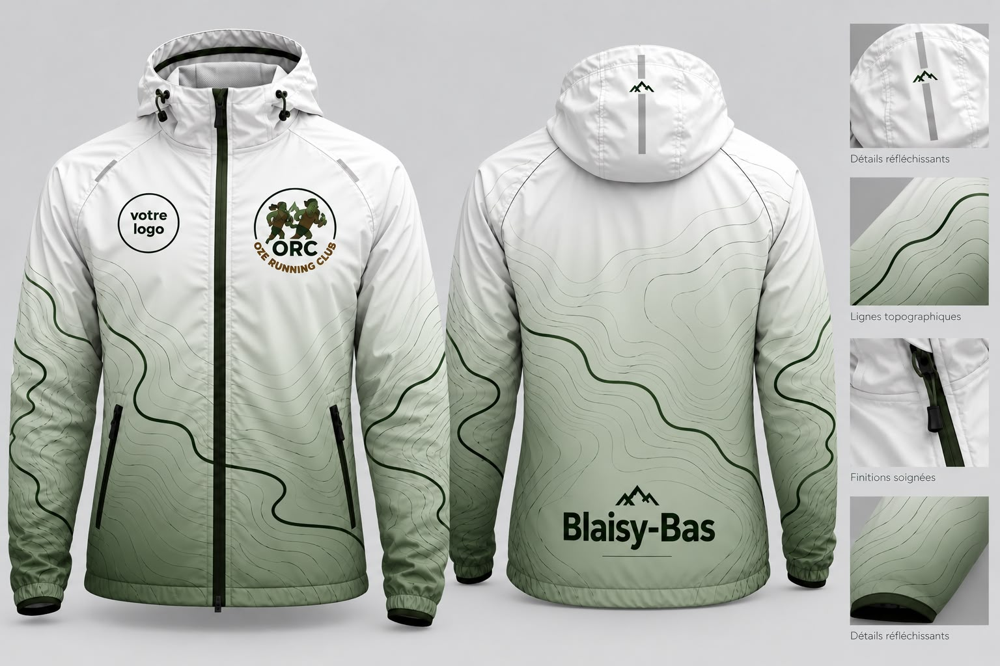

Oze Running Club est une association de course à pied basée à Blaisy-Bas. Nos coureuses et coureurs s'entraînent chaque semaine et participent à de nombreux trails et courses en Bourgogne et au-delà.

Vous êtes une entreprise, un commerce ou un artisan de la région et vous souhaitez soutenir le sport local ? Vous pouvez le faire de deux façons :

- **le sponsoring** : une prestation publicitaire, en échange d'un paiement, qui donne lieu à une facture ;
- **le mécénat** : un don, sans contrepartie publicitaire, qui peut ouvrir droit à une réduction d'impôt si les conditions fiscales sont remplies.

<section class="support-section support-section--sponsoring" aria-labelledby="sponsoring" markdown="1">
Sponsoring
<h2 id="sponsoring">Le sponsoring : gagnez en visibilité</h2>

Les prestations de sponsoring font l'objet d'une facture établie conformément au régime fiscal applicable à l'association.

<h3>Sponsor Foulée — 200 € / an</h3>

Pendant **un an** :

- votre logo sur notre [page Sponsors](/sponsors/) ;
- un lien vers le site de votre entreprise ;
- une visibilité prévue sur nos réseaux sociaux.

Une facture vous est remise.

<h3>Sponsor premium — 3 000 €</h3>

Pour la saison à venir, nous allons équiper nos membres d'environ **40 vestes aux couleurs du club**, portées à l'entraînement et sur les trails. Nous recherchons un sponsor premium pour financer ce projet.

<figure>
  
  <figcaption><em>Prototype de la veste du club : votre logo sur la poitrine, à côté de celui de l'ORC.</em></figcaption>
</figure>

En échange :

- votre logo sur la poitrine d'environ 40 vestes ;
- une visibilité lors des entraînements et des compétitions ;
- une présence renforcée sur notre [page Sponsors](/sponsors/), en tête de page, avec un lien vers votre site ;
- des remerciements sur nos réseaux sociaux.

Une facture vous est remise. C'est un projet unique, sans partenariat à long terme, mais avec une grosse visibilité sur les trails de la région.

<a class="btn" href="mailto:info@oze-running.club?subject=Sponsoring%20-%20Oze%20Running%20Club">Devenir sponsor</a>

</section>

<section class="support-section support-section--mecenat" aria-labelledby="mecenat" markdown="1">
Mécénat
<h2 id="mecenat">Devenez mécène : soutenez le running local !</h2>

Vous êtes artisan, commerçant, indépendant ou dirigeant d'une petite entreprise ?

Vous pouvez soutenir Oze Running Club par un don libre, par exemple de 200 € ou 500 €.

Votre générosité nous aide à financer les activités sportives, les équipements et le fonctionnement associatif du club.

En remerciement, nous pouvons mentionner discrètement le nom ou le logo de votre entreprise sur notre [page Sponsors](/sponsors/#nos-mecenes), sans publicité commerciale.

Le mécénat n'est pas une prestation : il ne donne pas lieu à une facture ni à une contrepartie publicitaire (les logos sur les vestes sont réservés au sponsoring).

<h3>Un avantage fiscal possible pour votre entreprise</h3>

Le mécénat d'entreprise peut ouvrir droit à une réduction d'impôt de 60 % du montant du don, dans les limites légales (article 238 bis du Code général des impôts).

Vous pouvez faire votre don dès maintenant : le reçu fiscal vous est adressé dans un second temps.

<a class="btn btn--mecenat" href="mailto:info@oze-running.club?subject=Demande%20de%20m%C3%A9c%C3%A9nat%20-%20Oze%20Running%20Club">Je souhaite soutenir Oze Running Club</a>

</section>

## Nous contacter

Pour devenir sponsor ou mécène, ou pour en savoir plus, écrivez-nous à <a href="mailto:info@oze-running.club">info@oze-running.club</a>. Retrouvez tous nos soutiens sur la page [Ils soutiennent Oze Running Club](/sponsors/).

Sportivement, 
L'équipe d'Oze Running Club
