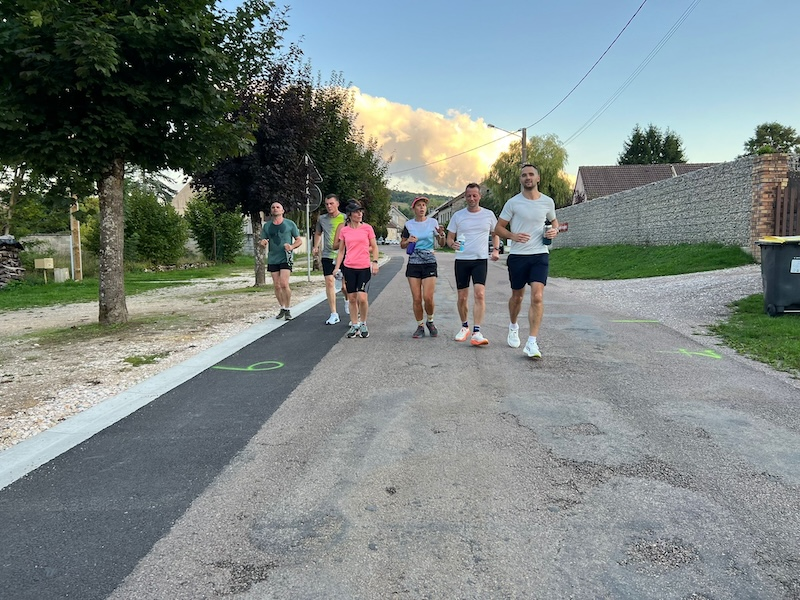
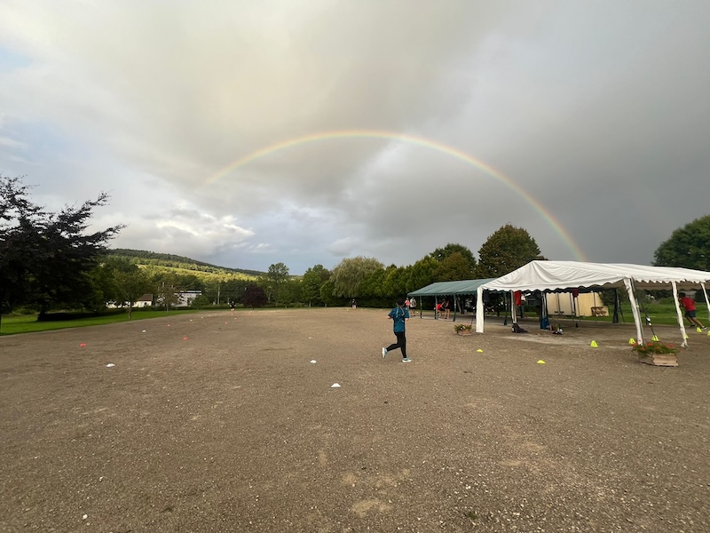
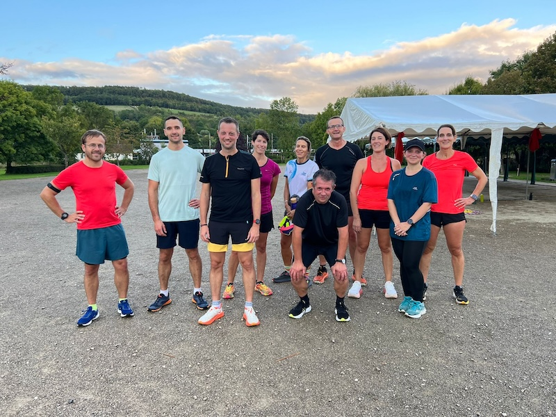
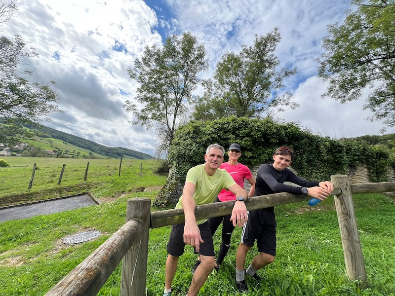

Oze Running Club (ORC) est une association loi 1901, qui a pour objectif de promouvoir la pratique régulière et
encadrée de la course à pied (route, trail, renforcement musculaire) à
Blaisy-Bas et aux alentours, dans une atmosphère conviviale.

L'association est ouverte à toutes et à tous les adultes, quel que soit le niveau.

  

    

      
    

    

      
    

    

      
    

    

      
    

  

  <button class="prev">‹</button>
  <button class="next">›</button>

# Actualités
<ul class="post-list">

  <li>
    {{ post.date | date: "%d/%m/%Y" }}
    <a class="post-link" href="{{ post.url | relative_url }}">{{ post.title | escape }}</a>
  </li>

</ul>

# Prochains Événements
<ul id="event-list" class="event-list"></ul>
