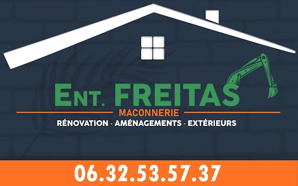

# Ils soutiennent Oze Running Club

Grâce au soutien des entreprises locales et de nos mécènes, Oze Running Club développe la pratique du running et du trail à Blaisy-Bas et dans ses environs. Chaque contribution nous aide à faire vivre notre association sportive.

<section class="support-section support-section--sponsoring" aria-labelledby="nos-sponsors">
  Sponsoring
  <h2 id="nos-sponsors">Nos sponsors</h2>
  
Nos sponsors soutiennent le club dans le cadre de partenariats publicitaires : en échange de leur participation, facturée, le club leur offre de la visibilité.

  

    
    

      <a href="https://www.entreprise-freitas-maconnerie.fr/" target="_blank" rel="noopener"><strong>Entreprise Freitas Maçonnerie</strong></a> :
      entreprise du BTP en Bourgogne spécialisée en maçonnerie, aménagements extérieurs et rénovation, pour les particuliers, les entreprises et les collectivités.
    

  

</section>

<section class="support-section support-section--mecenat" aria-labelledby="nos-mecenes">
  Mécénat
  <h2 id="nos-mecenes">Nos mécènes</h2>
  
Nos mécènes soutiennent librement les activités sportives d'Oze Running Club, sans contrepartie publicitaire.

  
En remerciement de leur générosité, nous pouvons mentionner leur nom ou leur logo de manière discrète, sans message commercial.

  <!--
    Liste des mécènes : nom (ou petit logo) uniquement, sans slogan, lien
    promotionnel ni message commercial. Exemple :
    <ul class="mecene-list">
      <li>Nom du mécène</li>
    </ul>
    Retirer le message « Soyez le premier mécène du club ! » dès le premier mécène.
  -->
  
<em>Soyez le premier mécène du club !</em>

</section>

<section class="support-cta" aria-labelledby="devenir-mecene">
  <h2 id="devenir-mecene">Entreprises locales, soutenez le sport près de chez vous !</h2>
  
Artisans, commerçants, indépendants, TPE : vous pouvez soutenir Oze Running Club par un don libre, du montant de votre choix. Par exemple :

  <ul class="amount-grid">
    <li><strong>200 €</strong> don libre</li>
    <li><strong>500 €</strong> don libre</li>
    <li><strong>Autre</strong> montant au choix</li>
  </ul>

  
Ces montants sont donnés à titre d'exemple : ce ne sont pas des formules, et tous nos mécènes sont remerciés de la même manière, quel que soit le montant de leur don.

  

    <h3>Un avantage fiscal possible</h3>
    
Sous réserve de l'éligibilité de l'association et du respect des conditions prévues à l'article 238 bis du Code général des impôts, les dons des entreprises peuvent ouvrir droit à une réduction d'impôt de 60 %, dans les limites légales.

    <ul>
      <li>Don de 200 € : réduction d'impôt potentielle de 120 €.</li>
      <li>Don de 500 € : réduction d'impôt potentielle de 300 €.</li>
    </ul>
    
Ces simulations supposent que l'entreprise puisse effectivement utiliser la réduction d'impôt. Oze Running Club procède actuellement à la vérification de son éligibilité au mécénat : la délivrance d'un reçu fiscal n'est donc pas garantie à ce stade.

  

  
<a class="btn btn--mecenat" href="mailto:info@oze-running.club?subject=Soutenir%20Oze%20Running%20Club%20%E2%80%93%20M%C3%A9c%C3%A9nat">Devenir mécène</a>

</section>

---

Vous préférez un partenariat publicitaire ? Découvrez nos offres de sponsoring (Sponsor Foulée, sponsor premium) et le mécénat en détail dans notre article [Entreprises locales : devenez sponsor ou mécène d'Oze Running Club !](/2026/11/09/appel-a-sponsors.html)

Pour toute question, contactez-nous à <a href="mailto:info@oze-running.club">info@oze-running.club</a>.
